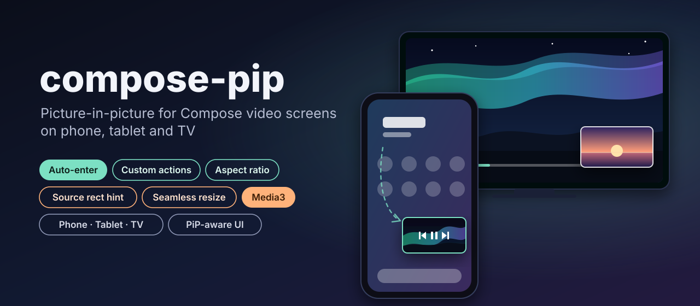
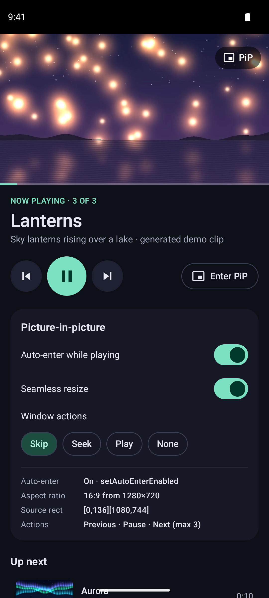
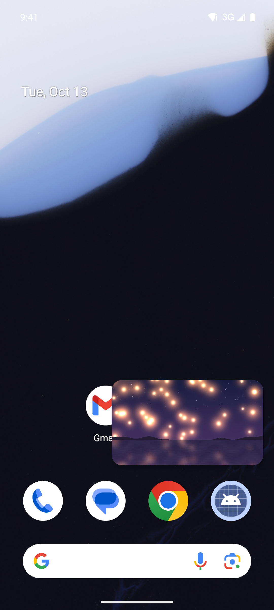
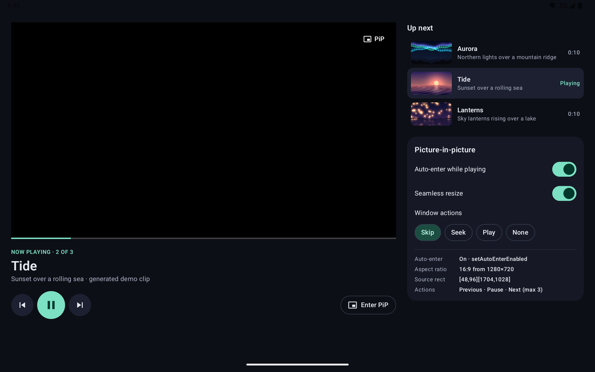
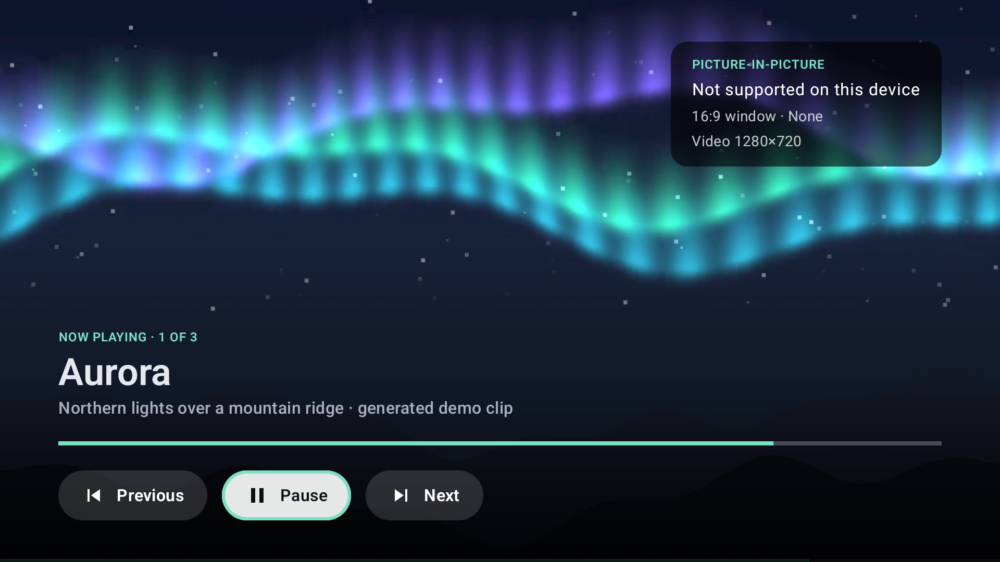

<p align="center">
  
</p>

<p align="center">
  <a href="https://github.com/halilozel1903/compose-pip/actions/workflows/ci.yml"></a>
  <a href="https://jitpack.io/#halilozel1903/compose-pip"></a>
  
  
  
  
  
  <a href="LICENSE"></a>
</p>

**compose-pip** adds picture-in-picture to Jetpack Compose video screens. One `rememberPipState` call keeps the activity's `PictureInPictureParams` in sync with your UI: auto-enter when the user goes home (with `setAutoEnterEnabled` on Android 12+ and an `onUserLeaveHint` fallback before that), the window's aspect ratio from the video size, a source rect hint taken from the video's layout bounds, seamless resize, and custom actions such as play/pause and skip that come back to your code through a private broadcast receiver. `isInPip` is Compose state and a `StateFlow`, so hiding the controls in the PiP window is one `HideInPip { }`. An optional Media3 module wires all of it to any `Player`.

```kotlin
val pip = rememberPlayerPipState(player)                 // pip-media3: everything below, from the Player

Box {
    PipPlayerSurface(player, pip, Modifier.fillMaxSize()) // SurfaceView + source rect hint
    HideInPip(pip) { PlayerControls(onPipClick = { pip.enter() }) }
}
```

## Screenshots

Captured by CI on Android emulators with the sample app, playing real video with Media3 ExoPlayer. The clips are **generated demo footage** bundled with the sample (northern lights, a sunset sea and sky lanterns, drawn frame by frame by [`scripts/generate-demo-clips.py`](scripts/generate-demo-clips.py)); they are not real-world recordings.

| Phone player | Phone in PiP over the launcher |
| :---: | :---: |
|  |  |

The PiP shot is a real picture-in-picture window. CI plays a clip, then presses Home with `adb shell input keyevent KEYCODE_HOME`; the sample has auto-enter on while playing, so Android moves it into PiP over the launcher. If auto-enter did not trigger, the script would bring the app back with `--ez enter_pip true`, which calls the same `enter()` as the in-app PiP button. The screenshot is only kept when the app's `OnPictureInPictureModeChangedProvider` callback reported PiP, the window bounds it reports are PiP sized, the pixels inside them are video and the screen no longer looks like the full screen player ([`scripts/verify-pip.py`](scripts/verify-pip.py)); otherwise the run fails rather than committing a stand-in.

The custom actions (previous, pause, next) only show when the PiP window is tapped, and System UI shows its menu for a few seconds. A tap timed through adb on a CI emulator is not reliable, so there is no screenshot of the PiP menu; the actions are listed live in the sample's panel ("Actions: Previous · Pause · Next (max 3)").

**Tablet** in landscape: video and controls on the left, PiP options and the playlist on the right.



**Android TV** (1080p): the video full screen with D-pad buttons. The Android TV emulator image used in CI does not support picture-in-picture, so the badge says so and the PiP button is hidden; on TV devices that support PiP, a Picture-in-picture button appears after Next.



## Features

- **`rememberPipState`**: one call per screen; parameters are re-applied whenever its arguments change, and only when they change.
- **`isInPip`** as Compose state (`PipState.isInPip`) and as a `StateFlow` (`PipController.isInPip`), from `OnPictureInPictureModeChangedProvider`. `rememberIsInPip()` for composables deep in the tree.
- **Auto-enter** that works on every version: `setAutoEnterEnabled` on Android 12+ (the window animates out during the home gesture), `enterPictureInPictureMode` from `onUserLeaveHint` on Android 8 to 11. Tie it to "is playing" so a paused video never floats over the launcher.
- **Aspect ratio** from the video size, including anamorphic pixel aspect ratios and rotation, always clamped to Android's 1:2.39 to 2.39:1 limit (an out-of-range ratio crashes `setPictureInPictureParams`).
- **`Modifier.pipSourceRect`**: the video's bounds in the window become the `sourceRectHint`, fitted to the aspect ratio so a letterboxed video starts the transition from the picture, not the bars. Frozen while in PiP, cleared when the video leaves the screen.
- **Seamless resize** on by default for video; turn it off for non-video content to get the system's cross-fade.
- **Custom actions** (`RemoteAction`s): play, pause, replay, previous, next, rewind, fast forward with icons included, or your own. Taps come back through `PipActionReceiver`: explicit, immutable `PendingIntent`s to a receiver that is not exported, so no other app can trigger them. Actions beyond the device's limit are dropped from the end; the Media3 helper shows play/pause alone when a device allows fewer than three.
- **PiP-aware UI**: `HideInPip { }` and `ShowInPip { }`.
- **Title and subtitle** for Android 13+ (shown on TV and in the PiP menu on some devices).
- **Media3** (optional module): `rememberPlayerPipState(player)` derives the aspect ratio, the actions, auto-enter while playing and pausing when the PiP window is closed from any `Player`; `PipPlayerSurface` renders into a `SurfaceView` and reports the source rect.
- **Without Compose**: `PipController(activity)` does the same for a classic `Activity` or `Fragment` screen.
- **Phone, tablet and TV**; minSdk 26, explicit API, platform-free logic unit tested in `pip-core`.

## Installation

Add JitPack to `settings.gradle.kts`:

```kotlin
dependencyResolutionManagement {
    repositories {
        google()
        mavenCentral()
        maven("https://jitpack.io")
    }
}
```

Then the dependency:

```kotlin
dependencies {
    implementation("com.github.halilozel1903.compose-pip:pip:1.0.0")

    // Optional: Media3 Player integration (aspect ratio, actions, auto-enter while playing, PipPlayerSurface).
    implementation("com.github.halilozel1903.compose-pip:pip-media3:1.0.0")
}
```

`pip-core` (aspect ratios, rectangles, action planning; pure Kotlin) comes with `pip`. The build is also set up for Maven Central (`io.github.halilozel1903:pip`) via the vanniktech publish plugin.

### Manifest

Picture-in-picture is declared per activity. The `configChanges` keep the activity, the player and its surface alive while the window shrinks and grows, instead of recreating it in the middle of the transition:

```xml
<activity
    android:name=".PlayerActivity"
    android:supportsPictureInPicture="true"
    android:resizeableActivity="true"
    android:launchMode="singleTask"
    android:configChanges="screenSize|smallestScreenSize|screenLayout|orientation" />
```

Without `supportsPictureInPicture`, `enter()` returns `false` and the library logs one warning instead of crashing.

## Usage

**With Media3**

```kotlin
@Composable
fun PlayerScreen(player: Player) {
    val pip = rememberPlayerPipState(
        player = player,
        autoEnterWhilePlaying = true,                 // Home while playing enters PiP
        actionLayout = MediaPipActionLayout.Skip,     // previous / play-pause / next; or Seek, PlayPause, None
        pauseOnStop = true,                           // closing the PiP window pauses
    )

    Column {
        PipPlayerSurface(
            player = player,
            pipState = pip,
            modifier = if (pip.isInPip) Modifier.fillMaxSize() else Modifier.fillMaxWidth().aspectRatio(16f / 9f),
        )
        HideInPip(pip) {
            Controls(player)
            if (pip.isSupported) Button(onClick = { pip.enter() }) { Text("Picture-in-picture") }
        }
    }
}
```

Keep the video surface at the same place in the composition and only change its modifier in PiP, as above: replacing it with another composable would recreate the `SurfaceView` mid-transition.

**With any video view**

```kotlin
val pip = rememberPipState(
    aspectRatio = PipAspectRatio.fromVideoSize(width = 1920, height = 800),   // 12:5, clamped if needed
    autoEnter = isPlaying,
    seamlessResize = true,
    actions = listOf(
        PipActions.seekBack(),
        PipActions.playPause(isPlaying),
        PipActions.seekForward(),
    ),
    title = "Episode 4",
    onAction = { action ->
        when (action.id) {
            PipActions.PLAY -> video.play()
            PipActions.PAUSE -> video.pause()
            PipActions.SEEK_BACK -> video.seekBy(-10.seconds)
            PipActions.SEEK_FORWARD -> video.seekBy(10.seconds)
        }
    },
)

MyVideoView(Modifier.pipSourceRect(pip))
HideInPip(pip) { MyControls() }
ShowInPip(pip) { /* rarely needed: something only for the PiP window */ }
```

**Your own actions**

```kotlin
val like = PipAction(id = "like", icon = R.drawable.ic_heart, title = "Like")
val pip = rememberPipState(actions = listOf(like, PipActions.playPause(isPlaying))) { action ->
    if (action.id == "like") viewModel.like()
}
```

Icons are drawables (vectors work) tinted white by System UI. Most phones show three actions (`pip.maxActions`); extra ones are dropped.

**Reading the mode**

```kotlin
pip.isInPip                         // Compose state
pip.isInPipFlow.collect { ... }     // StateFlow, outside composition
val inPip by rememberIsInPip()      // anywhere below, without the PipState
pip.autoEnterStrategy               // Params (API 31+), UserLeaveHint (26-30) or Off
pip.sourceRectHint                  // the hint in use, in window pixels
```

**Without Compose**

```kotlin
class PlayerActivity : ComponentActivity() {
    private lateinit var pip: PipController

    override fun onCreate(savedInstanceState: Bundle?) {
        super.onCreate(savedInstanceState)
        pip = PipController(this, PipConfig(aspectRatio = PipAspectRatio.Widescreen, autoEnter = true))
        pip.onAction = { action -> if (action.id == PipActions.PAUSE) player.pause() else player.play() }
        lifecycleScope.launch { pip.isInPip.collect { inPip -> controls.isVisible = !inPip } }
    }

    fun onPlayingChanged(playing: Boolean) = pip.update {
        it.copy(autoEnter = playing, actions = listOf(PipActions.playPause(playing)))
    }

    override fun onDestroy() {
        pip.release()
        super.onDestroy()
    }
}
```

Building `PictureInPictureParams` yourself? `PipActionReceiver(context) { id -> ... }` gives you the `RemoteAction`s and the receiver on their own.

### Android TV

PiP works the same on TV (where the system supports it; check `pip.isSupported`). There is no touch, so give the user a focusable PiP button; TV shows the custom actions and the title in its PiP menu. The sample has a D-pad layout with a "Picture-in-picture" button.

## API

| API | Module | What it does |
| --- | --- | --- |
| `rememberPipState(aspectRatio, autoEnter, seamlessResize, actions, title, subtitle, onAction)` | `pip` | PiP for the hosting activity, kept in sync with the arguments; returns `PipState` |
| `PipState.isInPip`, `isInPipFlow`, `isSupported`, `maxActions`, `config`, `sourceRectHint`, `autoEnterStrategy`, `enter()` | `pip` | Mode as state and flow, device limits, live parameters, enter now |
| `Modifier.pipSourceRect(state, fitToAspectRatio = true)` | `pip` | Uses the element's window bounds as the source rect hint |
| `HideInPip(state) { }`, `ShowInPip(state) { }` | `pip` | Content only outside / inside PiP |
| `rememberIsInPip()` | `pip` | PiP mode as `State<Boolean>` without changing parameters |
| `rememberMaxPipActions()` | `pip` | The device's custom action limit |
| `PipController(activity, config)` | `pip` | The non-Compose core: `config`, `update { }`, `enter()`, `isInPip: StateFlow`, `onAction`, `release()` |
| `PipConfig` | `pip` | Aspect ratio, source rect hint, auto-enter, seamless resize, actions, title, subtitle |
| `PipAction`, `PipActions.play()`, `pause()`, `playPause(isPlaying)`, `replay()`, `skipPrevious()`, `skipNext()`, `seekBack()`, `seekForward()` | `pip` | Custom actions with bundled icons |
| `PipActionReceiver(context, onAction)` | `pip` | `PendingIntent`s and `RemoteAction`s delivered to a non-exported receiver |
| `PipAspectRatio.of(w, h)`, `fromVideoSize(w, h, pixelRatio, rotation)`, `Widescreen`, `Standard`, `Square`, `Portrait`, `Min`, `Max` | `pip-core` | Reduced, clamped aspect ratios |
| `PipRect`, `fit(aspectRatio)` | `pip-core` | Window rectangles; the picture's rectangle inside a letterboxed box |
| `MediaPipActionPlanner.plan(...)`, `MediaPipActionLayout` | `pip-core` | Which media actions to show for a player state and device limit |
| `PipApiLevels.autoEnterStrategy(sdkInt, autoEnter)` | `pip-core` | `Params`, `UserLeaveHint` or `Off` |
| `rememberPlayerPipState(player, autoEnterWhilePlaying, actionLayout, seamlessResize, fallbackAspectRatio, pauseOnStop, title, subtitle)` | `pip-media3` | Everything above from a Media3 `Player` |
| `PipPlayerSurface(player, pipState, modifier)` | `pip-media3` | `SurfaceView` output letterboxed to the video, reporting the source rect |
| `rememberPlayerPipSnapshot(player)`, `Player.pipSnapshot()`, `Player.pipAspectRatio()`, `Player.perform(action)` | `pip-media3` | Player state for PiP and running PiP actions on a player |

## Sample app

The `sample` module is "PiP Player", a video player for phones, tablets and Android TV. It plays a playlist of three bundled 10 second clips (1280 x 720 H.264, generated demo footage, no network) with ExoPlayer and `rememberPlayerPipState`. A panel shows the options (auto-enter, seamless resize, which actions) and what the library is doing live: the auto-enter path, the aspect ratio and the video size it came from, the source rect hint and the actions in the PiP window.

```bash
./gradlew :sample:installDebug
adb shell am start -n io.github.halilozel1903.pip.sample/.MainActivity
adb shell input keyevent KEYCODE_HOME                        # auto-enter: the video floats over the launcher
adb shell am start -n io.github.halilozel1903.pip.sample/.MainActivity --ez enter_pip true   # enter PiP from the app
```

`--es scene player` makes the sample log `SCENE_READY player` once video frames are on screen and playback has run a few seconds; it always logs `PIP_MODE` changes and, in PiP, the window's `PIP_BOUNDS`. `scripts/screenshots.sh` (phone, tablet, tv) uses these to capture only real playback and a verified PiP window. To regenerate the clips: `pip install numpy pillow imageio-ffmpeg && python3 scripts/generate-demo-clips.py`.

## Project structure

| Module | What it is |
| --- | --- |
| `pip-core` | Pure Kotlin: `PipAspectRatio`, `PipRect`, `MediaPipActionPlanner`, `PipApiLevels`. Unit tested. Published as `pip-core` |
| `pip` | Android + Compose: `PipController`, `rememberPipState`, `Modifier.pipSourceRect`, `HideInPip`, `PipActions`, `PipActionReceiver`. Published as `pip` |
| `pip-media3` | Media3 `Player` integration: `rememberPlayerPipState`, `PipPlayerSurface`. Published as `pip-media3` |
| `sample` | PiP Player for phone, tablet and TV, with screenshot scenes |

## Tech stack

Kotlin 2.4 · AGP 9.4 with built-in Kotlin · Gradle 9.6 · Jetpack Compose (BOM 2026.09) · Material 3 (sample) · AndroidX Activity 1.13 · AndroidX Media3 1.8 (ExoPlayer in the sample) · GitHub Actions with phone, tablet and Android TV emulators

## License

MIT. See [LICENSE](LICENSE). The demo clips in `sample/src/main/assets/clips` are generated by this repository's script and are covered by the same license.
